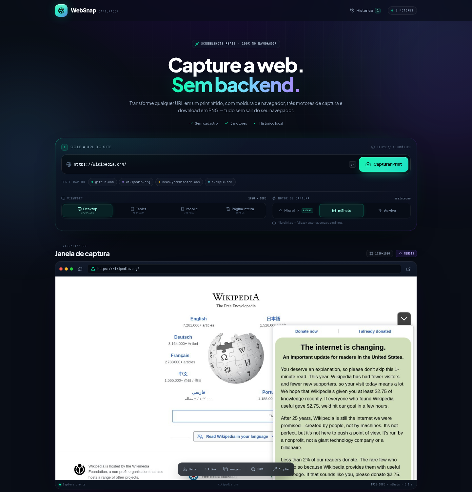

# WebSnap — Capturador de Sites

Screenshots reais de qualquer URL, direto no navegador. O app inteiro vive em um único `index.html`, sem backend próprio, sem build e sem cadastro.

[](https://console.zenifra.com/deploy?repository=https://github.com/ramonpaolo/websnap&port=3000)
[](https://websnap.clients.zenifra.com)

**Hospedado na Zenifra:** [websnap.clients.zenifra.com](https://websnap.clients.zenifra.com)



## Deploy na Zenifra

O botão acima abre o Console da Zenifra com **este repositório** e a **porta 3000** já preenchidos. Você faz login, revisa nome, plano e configurações e confirma a criação — nada é criado apenas por abrir o link.

- **App em produção:** [websnap.clients.zenifra.com](https://websnap.clients.zenifra.com)
- **Documentação do botão:** [Deploy na Zenifra](https://docs.zenifra.com/pt/docs/deploy/deploy-button)

O repositório é público, então o deploy não exige conectar sua conta GitHub. O build usa o runtime Node da Zenifra (`npm start`); o `Dockerfile` serve para self-hosting fora da plataforma. Um projeto criado pelo botão usa deploy manual; para atualizar a cada push, conecte o GitHub no Console depois.

## O que ele faz

- **URL inteligente:** aceita `github.com` ou uma URL completa, adiciona `https://` automaticamente e valida o domínio.
- **Quatro viewports:** Desktop `1920×1080`, Tablet `768×1024`, Mobile `375×812` e Página inteira com rolagem interna.
- **Três motores:** Microlink como padrão, mShots como fallback automático e um modo Ao vivo em iframe.
- **Moldura de navegador:** controles estilo macOS, barra de endereço com HTTPS, recarregar e link para o site original.
- **Estados de carregamento:** skeleton do site, spinner, barra de progresso, etapas e mensagens que mudam conforme a captura avança.
- **Ações sobre o print:** baixar PNG, copiar link, copiar imagem, zoom de 100%/150% e lightbox em tela cheia.
- **Histórico local:** últimas 8 capturas com miniatura, URL, viewport, motor e horário. Clique para restaurar; inclui desfazer ao limpar.
- **Erros tratados:** URL inválida, timeout, rate-limit, falha dos dois motores, preview assíncrono do mShots e bloqueio de iframe.

## Rodando localmente

O app não precisa de build. A forma mais simples é servir o arquivo:

```bash
python3 -m http.server 4173
# abra http://localhost:4173
```

Também é possível abrir o `index.html` diretamente no navegador.

Para usar o servidor de produção incluído no repositório:

```bash
npm start
# abra http://localhost:3000
```

O servidor usa apenas a biblioteca padrão do Node, serve o `index.html` e expõe `GET /healthz`.

## Docker

```bash
docker build -t websnap .
docker run --rm -p 3000:3000 websnap
```

A imagem final usa Node 22 Alpine, roda como usuário `node`, escuta na porta `3000` e tem healthcheck em `/healthz`.

## Motores de captura

| Motor | Como funciona | Observações |
| --- | --- | --- |
| **Microlink** | `api.microlink.io` com `screenshot=true` e parâmetros de viewport | Motor padrão. A API pública tem limite de requisições; falhas caem automaticamente para o mShots. |
| **mShots** | Imagem em `s0.wp.com/mshots/v1/...` | Renderização assíncrona. A primeira chamada redireciona para `/default` (placeholder 400×300); o app detecta isso e faz polling até o preview ficar pronto. Não gera página inteira. |
| **Ao vivo** | Iframe com `sandbox="allow-scripts allow-same-origin"` | Interativo. Sites com `X-Frame-Options` ou CSP podem bloquear a incorporação; o app avisa e oferece abrir em nova aba. |

## Privacidade e limites

- A URL informada é enviada ao serviço de captura escolhido (Microlink ou WordPress mShots). O WebSnap não tem backend próprio.
- O histórico e as preferências ficam somente no `localStorage` do navegador.
- O download da imagem depende de CORS. Quando o servidor da imagem bloqueia o `fetch`, o app abre o print em uma nova aba para que ele possa ser salvo manualmente.
- As APIs gratuitas não têm SLA. Para uso intenso, troque o motor de captura por uma API paga com chave e cota garantida.
- O Tailwind é carregado via CDN para manter o projeto em um arquivo único. Para uma versão com CSP estrita, gere o CSS em um build separado.

## Estrutura

```text
.
├── index.html          # aplicação completa (HTML + CSS + JavaScript)
├── server.mjs          # servidor HTTP mínimo para produção
├── Dockerfile          # imagem Node 22 Alpine
├── package.json
├── docs/screenshot.png
└── README.md
```

## Stack

HTML5, CSS, JavaScript Vanilla, [Tailwind CSS](https://tailwindcss.com/) via CDN, [Lucide Icons](https://lucide.dev/), [Plus Jakarta Sans e JetBrains Mono](https://fonts.google.com/).

## Créditos

- [Microlink](https://microlink.io/) — API de screenshots.
- [WordPress mShots](https://github.com/Automattic/mShots) — preview assíncrono de sites.
- [Lucide](https://lucide.dev/) — ícones.
- [Tailwind CSS](https://tailwindcss.com/) — utilitários de layout.
- [Google Fonts](https://fonts.google.com/) — tipografia.
